

<a href="https://streamlineagency.eu">
  
</a>

 

 


  

<table>
  <tr>
    <td width="50%"></td>
    <td width="50%"></td>
  </tr>
  <tr>
    <td width="50%"></td>
    <td width="50%"></td>
  </tr>
  <tr>
    <td width="50%"></td>
    <td width="50%"></td>
  </tr>
  <tr>
    <td colspan="2" align="center"></td>
  </tr>
</table>

 

  <a href="https://tikyline.com"></a>

 

<table>
  <tr>
    <td width="33%" align="center"><a href="https://github.com/cauctoflo"></a></td>
    <td width="33%" align="center"><a href="https://github.com/naileclevrai"></a></td>
    <td width="33%" align="center"><a href="https://github.com/Masdestructor"></a></td>
  </tr>
</table>

 

**Back-end** 

**Front-end** 

**Données & infra** 

**Communauté & outils** 

 


